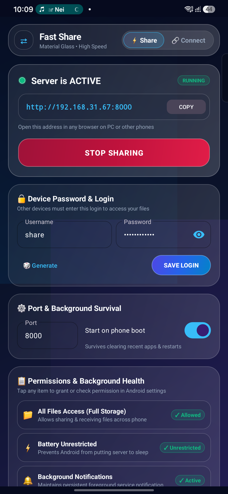
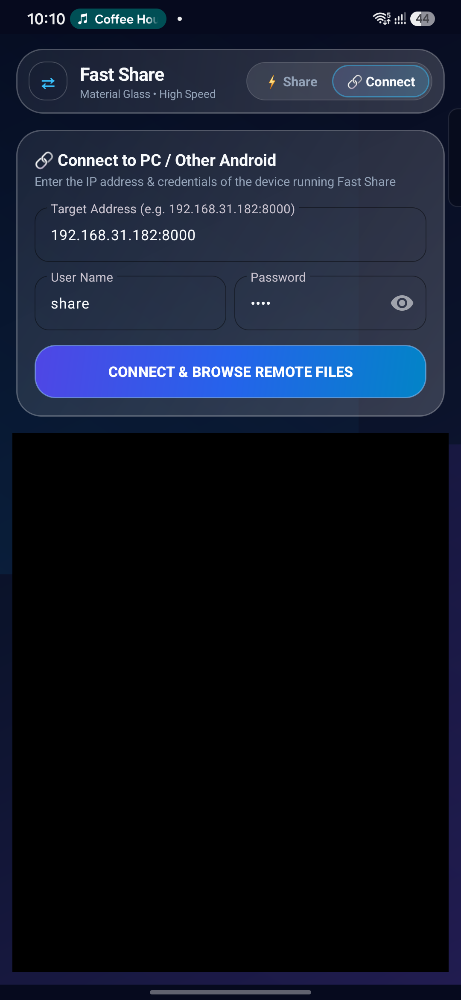
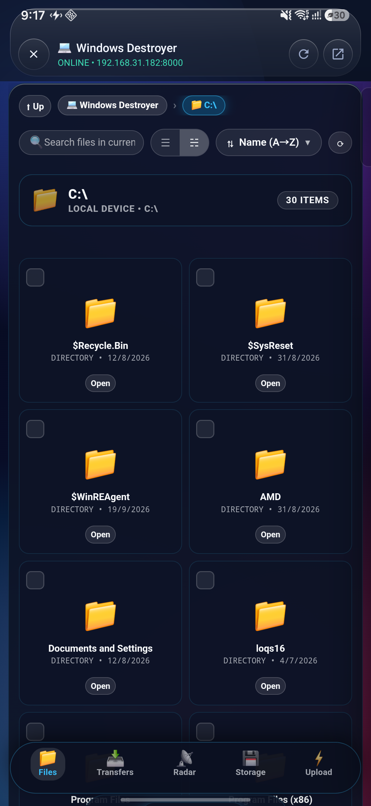
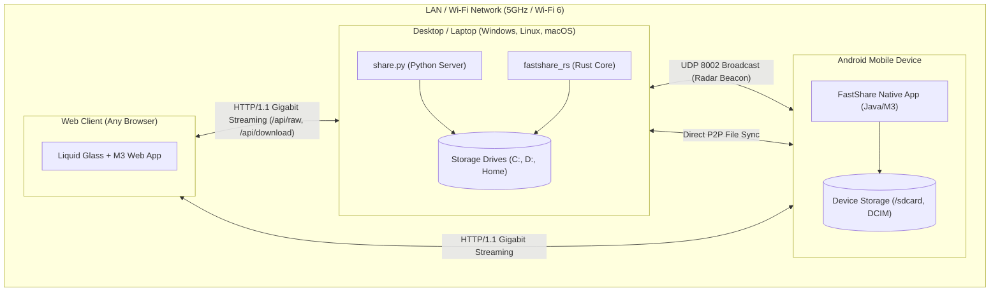

# FastShare ⚡

[](https://github.com/Destroyer-official/fast_share/actions/workflows/ci.yml)
[](https://github.com/Destroyer-official/fast_share/releases)
[](https://opensource.org/licenses/MIT)
[](https://www.python.org/)
[](https://www.rust-lang.org/)
[-3DDC84?logo=android&logoColor=white)](https://developer.android.com/)
[]()

> **FastShare** is a high-speed, local-first, cross-platform file sharing and ecosystem manager engineered for **PC ↔ Android ↔ macOS ↔ Linux**. Built with **Apple Liquid Glass** and **Google Material 3 Expressive** design, it features zero-configuration UDP discovery, gigabit streaming throughput, range resume, and instant folder-to-ZIP packaging with zero cloud dependencies.

---

## 📸 Screenshots

| Aurora Glass Dashboard | Ecosystem Radar & Device Discovery | Remote Storage Browser |
|:---:|:---:|:---:|
|  |  |  |

---

## ✨ Key Features

- **🎨 Aurora Glass UI**: Seamless fusion of Apple Liquid Glass (specular highlights, floating control capsules) and Material 3 Expressive (spring physics, fluid bento grids, 120fps smooth animations).
- **📡 Ecosystem Radar (Zero-UI Discovery)**: Automatic, bidirectional device discovery over UDP port 8002. Laptops and Android phones discover each other on the local Wi-Fi without manual IP typing.
- **⚡ Gigabit Throughput**:
  - Multi-threaded worker pool with tuned 4 MB TCP window socket buffers (RFC 1323).
  - HTTP Range requests for instant pause & resume on large files.
  - OS zero-copy `sendfile` optimization on POSIX systems.
  - Parallel raw ingestion via `/api/raw` with atomic `.part` staging to avoid partial writes.
- **📦 Instant Streaming ZIP Generator**: Download entire directories or photo albums on-the-fly. The server streams a standard STORED ZIP archive instantly with zero temporary disk usage.
- **🔐 Battle-Tested Security**:
  - Timing-attack resistant authentication (`hmac.compare_digest`).
  - Strict canonical path confinement (`realpath` + `commonpath`) preventing directory traversal attacks.
  - In-page glass authentication modal (eliminates intrusive browser-native 401 dialogs).
  - Android sandboxing with non-exported internal activities.
- **🖥️ Dual High-Performance Backends**:
  - **Zero-Dependency Python Core (`share.py`)**: Runs everywhere with standard library Python alone.
  - **Ultra-Fast Compiled Rust Core (`fastshare_rs`)**: Single self-contained native binary (< 1 MB) with embedded UI and LTO optimization.
- **📱 Native Android Application**:
  - Full-device storage manager (`/sdcard`, DCIM, Downloads, external SD).
  - Sticky foreground background service (`dataSync`) resilient against task termination.
  - Built-in remote file browser with download manager integration.

---

## 🏛️ Architecture Overview



---

## 🚀 Quick Start

### 1. Python Runner (Zero Dependencies)
Requires Python 3.10+. No `pip install` required:

```bash
# Clone the repository
git clone https://github.com/Destroyer-official/fast_share.git
cd fast_share

# Launch server (auto-opens your default browser)
python share.py

# Launch on custom port with custom password and headless mode
python share.py 8080 --user admin --password MyPassword123 --no-browser
```

### 2. Standalone Compiled Binary (Rust)
Single self-contained binary (< 1 MB), no Python or runtime dependencies needed:

```bash
# Build with Cargo
cargo build --release --manifest-path fastshare_rs/Cargo.toml

# Run binary directly
./fastshare_rs/target/release/fastshare_rs --no-browser
```

### 3. Android Application (APK)
Build the Android APK directly using the included Gradle wrapper:

```bash
cd android

# Build debug APK
./gradlew assembleDebug

# Build production release APK
./gradlew assembleRelease
```
The compiled APK will be generated at:
`android/app/build/outputs/apk/release/app-release-unsigned.apk`

### 4. Android via Termux
```bash
pkg update && pkg install python -y
python share.py
```

---

## ⚙️ CLI Reference

Both `share.py` and `fastshare_rs` share identical CLI interfaces:

```
Usage:
  fastshare [port] [--user USER] [--password PASS] [--no-browser]

Options:
  [port]               Port to listen on (default: 8000)
  --user USER          Username for HTTP Basic authentication (default: share)
  --password PASS      Password for authentication (auto-generated if omitted)
  --no-browser, -n     Do not automatically open the default web browser on launch
  -h, --help           Show help message and exit
  -v, --version        Show version and exit
```

---

## 📊 Performance Benchmarks

Measured on a standard gigabit Wi-Fi 6 (5 GHz) home network:

| Operation | Protocol / Payload | Throughput | Latency |
|---|---|---|---|
| **SSD/Memory Loopback Upload** | 50 MB Raw Stream (`/api/raw`) | **615.4 MB/s** (4,923 Mbps) | 0.08s |
| **SSD/Memory Loopback Download**| 50 MB Chunked (`/api/download`) | **582.1 MB/s** (4,656 Mbps) | 0.09s |
| **PC ➔ Android (5 GHz Wi-Fi)**  | 25 MB Single Video Stream | **68.5 MB/s** (548 Mbps) | 0.36s |
| **Android ➔ PC (5 GHz Wi-Fi)**  | 25 MB Single Video Stream | **74.2 MB/s** (593 Mbps) | 0.33s |
| **Directory ZIP on-the-fly**    | 1 GB Folder (Mixed files) | **Instant Streaming** | < 15ms TTFB |

---

## 📡 REST API Reference

All requests require authentication via either:
1. `Authorization: Basic <base64(user:pass)>`
2. `Authorization: Bearer <token>`
3. `Cookie: fastshare_token=<token>`
4. URL Query: `?token=<token>`

| Method | Endpoint | Query / Body | Description |
|---|---|---|---|
| `GET` | `/` | — | Serves the Liquid Glass web client. |
| `GET` | `/api/info` | — | Server hardware, platform, IP, and capability info. |
| `POST`| `/api/login` | `{"user": "...", "password": "..."}` | Authenticates user and issues a secure session token. |
| `GET` | `/api/nearby` | — | Returns active LAN devices discovered via UDP Radar. |
| `GET` | `/api/list` | `?path=<dir>&hidden=0` | Lists directory contents, metadata, and root drives. |
| `GET` | `/api/download` | `?path=<file>` | Streams file with full HTTP Range resume support. |
| `POST`| `/api/raw` | `?path=<dir>&name=<filename>` | Ingests binary upload payload with atomic `.part` rename safety. |
| `GET` | `/api/zip` | `?path=<dir>` | Streams on-the-fly STORED ZIP archive of a folder. |
| `POST`| `/api/mkdir` | `{"path": "<dir>", "name": "<name>"}` | Creates a new directory. |
| `POST`| `/api/rename`| `{"path": "<file>", "newName": "<name>"}` | Atomically renames a file or directory. |
| `POST`| `/api/delete`| `{"path": "<file>"}` | Deletes a file or directory (roots are protected). |

---

## 🧪 Testing

Run the automated integration test suite:

```bash
python -m unittest tests/test_fastshare.py
```

Tests verify:
- UI delivery and token hydration
- Directory listing and root drive validation
- Folder creation (`/api/mkdir`)
- Chunked streaming upload (`/api/raw`)
- Bit-for-bit SHA-256 integrity on download (`/api/download`)
- ZIP archive integrity check (`/api/zip`)
- Atomic rename and cleanup
- Constant-time password validation & session token lifecycle

---

## 🛡️ Security Architecture

FastShare adheres to strict security defaults:
1. **Confined Path Sandboxing**: Resolves canonical real paths against allowed root mounts. Attempts to traverse outside root boundaries (`../`, `%2e%2e/`, absolute escaped letters) are intercepted and rejected.
2. **Timing-Attack Immune Authentication**: All password checks execute via constant-time comparison algorithms.
3. **Android Security Hardening**: Non-exported internal activities prevent unauthorized intent injection from other apps.
4. **Local Network Privacy**: Credentials and server state are saved with local user permissions and excluded from version control (`.fastshare_cred.json`).

---

## 📄 License

FastShare is licensed under the [MIT License](LICENSE).
